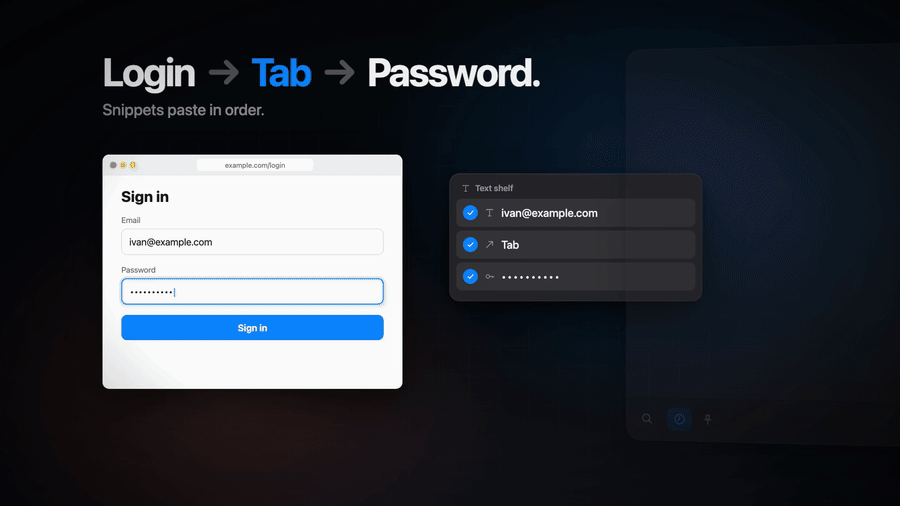
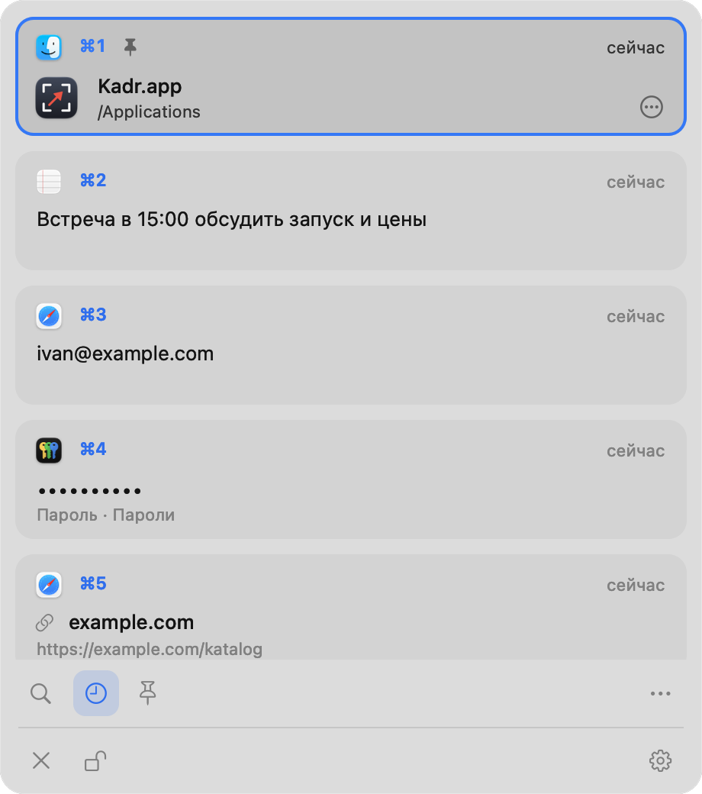

# Kadr

<p align="center">
  
</p>

<p align="center">
  <a href="https://github.com/Lutfulla01/kadr/releases/download/v1.4/kadr-promo-16x9.mp4">Видео на 43 секунды (MP4)</a>
  ·
  <a href="https://github.com/Lutfulla01/kadr/releases/latest">Скачать dmg</a>
</p>

<p align="center">
  <picture>
    <source media="(prefers-color-scheme: dark)" srcset="docs/images/history-dark.png">
    
  </picture>
</p>

Kadr — утилита для macOS, которая живёт в строке меню. Она делает снимки экрана и открывает их в редакторе пометок.
Снимок можно закрепить поверх окон или распознать на нём текст. Ещё в Kadr есть полка для перетаскивания файлов,
текстовая полка с готовыми фразами и зашифрованная история буфера обмена. История открывается нажатием тачпада
тремя пальцами.

Kadr не ходит в сеть: в нём нет телеметрии, проверки обновлений и аккаунтов. Окна появляются только по вашему действию.

[English version below](#english)

## Возможности

- **Снимки:** область (Пробел переключает на окно), окно, весь экран под курсором. Снимок сразу копируется
  в буфер обмена и сохраняется в `~/Pictures/Screenshots`. Системные ⌘⇧3/4/5 Kadr не занимает.
- **Редактор пометок.** Инструменты: стрелка, линия, прямоугольник, овал, ручка, маркер, текст, мозаика,
  нумерация, обрезка. Есть 7 цветов, отмена и повтор, масштаб. ⌘C копирует результат и закрывает редактор.
- **Закрепление.** Снимок висит поверх всех окон. Колесо или щипок меняют масштаб, ⌥ с колесом — прозрачность.
- **Распознавание текста (OCR)** на русском и английском, через Vision. Текст с экрана сразу попадает в буфер
  или распознаётся с уже сделанного снимка.
- **Полка для файлов.** Начните тащить файл, картинку, текст или ссылку и встряхните курсор: полка появится под ним.
  Потом унесите со стопки всё разом или по одному.
- **Текстовая полка:** постоянный набор фраз. Щелчок копирует фразу, её можно перетащить в поле.
  Отмеченные фразы вставляются по очереди.
- **История буфера в карточках.** Сохраняются текст, ссылки, картинки и файлы вместе с программой-источником.
  - Печатайте, чтобы искать. Фильтры по типу и закреплённые записи — в меню «…».
  - ⌘1–⌘9 вставляют карточку с этим номером.
  - ⌘-щелчок по нескольким карточкам и ↩ вставляют их по очереди через Tab, например логин и пароль.
- **Нажатие тачпада тремя пальцами (до щелчка):**
  - если в программе выделен текст, он копируется;
  - если выделения нет, сбоку выезжает панель истории;
  - тот же жест прячет панель.
- **Панель у края экрана:** история по упору курсора в край. По желанию, по умолчанию выключена.
- **Локальное шифрование.** История зашифрована на диске, пароли в списке скрыты точками.
- **Никакой сети** — ни одного сетевого вызова в коде.

Интерфейс на русском. Нужна macOS 14 Sonoma или новее, Apple Silicon или Intel.

## Сочетания по умолчанию

| Действие | Клавиши |
|---|---|
| Снимок области → редактор (Пробел — переключить на окно) | ⌥⇧4 |
| Снимок окна → редактор | ⌥⇧5 |
| Весь экран под курсором → редактор | ⌥⇧3 |
| Текст с экрана (OCR) → буфер обмена | ⌥⇧2 |
| Новая полка | ⌥⇧D |
| Текстовая полка | ⌥⇧T |
| История буфера | ⌥⇧V |
| Скопировать выделение или открыть / спрятать историю | нажатие тачпада тремя пальцами |

Все сочетания меняются в «Настройки…» (меню значка Kadr).

**В редакторе:**

- инструменты: V выделение, A стрелка, L линия, R прямоугольник, O овал, F ручка, M маркер, X текст,
  B мозаика, N нумерация, C обрезка;
- цвет: 1–7;
- действия: ⌘C или ⌘↩ скопировать и закрыть, ⌘S сохранить, ⌘⇧S сохранить как, P закрепить,
  T распознать текст, ⌘D положить на полку, ⌘Z / ⌘⇧Z отмена и повтор, Esc закрыть.

**В истории:**

- печать начинает поиск;
- ↩ вставить, ⌘↩ вставить простым текстом, ⌘1–⌘9 вставить карточку N;
- ⌘C скопировать, пробел — просмотр, ⌘P закрепить, Delete удалить;
- Tab переключает фильтр, Esc закрывает.

**Закреплённый снимок:** правая кнопка открывает меню, двойной щелчок или Esc закрывают.

## Установка из готового образа

1. Скачайте `Kadr-<версия>.dmg` со страницы Releases.
2. Откройте образ и перетащите Kadr в «Программы».
3. Запустите Kadr. Сборка не нотаризована Apple, поэтому macOS сначала скажет, что не может проверить программу,
   и не откроет её. Нажмите «Готово». Разрешить запуск нужно один раз:
   - Системные настройки → Конфиденциальность и безопасность;
   - внизу, у строки про Kadr, нажмите «Всё равно открыть» и подтвердите паролем или Touch ID;
   - снова запустите Kadr и в диалоге нажмите «Открыть».

   Если вы доверяете файлу, можно вместо этого снять карантин из Терминала:
   `xattr -dr com.apple.quarantine /Applications/Kadr.app`.
4. В строке меню появится значок видоискателя. Kadr сам добавит себя в автозапуск.
   Это выключается в «Настройки…» → «Запускать при входе».

Образы в Releases подписаны ad-hoc, без сертификата разработчика. Подробнее — в разделе «Подпись» ниже.

## Сборка из исходников

Нужно:

- macOS 14 или новее, Apple Silicon или Intel;
- Command Line Tools с Swift 6 (`xcode-select --install`). Полный Xcode не нужен;
- больше ничего: ни зависимостей, ни менеджера пакетов. Иконка и фон образа рисуются кодом при сборке.

```sh
git clone https://github.com/Lutfulla01/kadr.git
cd kadr
./build.sh app     # только собрать build/Kadr.app (универсальный: arm64 + x86_64)
./build.sh         # собрать, установить в /Applications и перезапустить Kadr
./build.sh dmg     # собрать образ dist/Kadr-<версия>.dmg
```

`KADR_DMG_LAYOUT=1 ./build.sh dmg` ещё и раскладывает окно образа: фон, стрелка, позиции значков.
Для этого Finder ненадолго откроет окно на экране.

### Подпись

`build.sh` подписывает приложение с hardened runtime. Сертификат берётся так:

1. из переменной окружения `KADR_SIGN_IDENTITY` (имя сертификата или его SHA-1);
2. иначе из первой строки файла `.signing` в корне проекта. Файл в git не попадает;
3. иначе подпись ad-hoc (`-`).

Список своих сертификатов: `security find-identity -v -p codesigning`.
Подойдёт и бесплатный «Apple Development» из Xcode.

С ad-hoc подписью всё работает, но для macOS каждая пересборка — новая программа:
- macOS снова спросит «Запись экрана» и «Универсальный доступ». Старые строки Kadr в настройках можно удалить;
- ключ истории в связке ключей привязан к подписи. При первом запуске новой сборки или новой версии из Releases
  macOS попросит пароль связки ключей «Вход», чтобы дать ей доступ к ключу. Введите пароль и нажмите
  «Разрешать всегда». Если отказать, история будет жить только в памяти до выхода. Старые записи на диске
  при этом не удаляются.

Если вы часто пересобираете Kadr, подписывайте его своим сертификатом. Тогда разрешения и доступ к ключу сохраняются.

## Разрешения

- **Запись экрана** нужна для снимков и распознавания текста. macOS спросит при первом снимке.
  Включите Kadr в разделе «Конфиденциальность и безопасность → Запись экрана» и перезапустите его.
- **Универсальный доступ** нужен для трёх вещей:
  - вставка за вас из истории и текстовой полки (Kadr нажимает ⌘V в программе, где вы были);
  - жест тремя пальцами;
  - чтение выделенного текста для копирования жестом.

  Без этого разрешения ↩ только копирует, а жест выключен. Kadr попросит его при первой вставке.

Kadr не меняет системные настройки и не трогает системные сочетания снимков.

## Приватность

- История буфера записывает всё, что вы копируете, включая пароли из менеджеров паролей.
  В списке пароли скрыты точками, глаз открывает их на время. В настройках можно:
  - не записывать пароли и скрытые записи;
  - задать список программ-исключений;
  - ограничить число записей и их возраст.
- Всё хранится только на этом Mac: `~/Library/Application Support/Kadr/`.
  - История зашифрована AES-GCM (CryptoKit). 256-битный ключ лежит в связке ключей входа,
    под службой `uz.lutfulla.kadr.clipboard`.
  - Без ключа прочитать историю нельзя. Если ключ пропал, Kadr начинает новую историю.
- Сети нет совсем: ни запросов, ни телеметрии, ни отчётов о сбоях. Журнал — локальный файл
  `~/Library/Logs/Kadr.log`, до 1 МБ, с ротацией. Содержимого буфера в нём нет.

## Удаление

1. «Настройки…» → выключите «Запускать при входе», затем в меню значка — «Выйти».
2. Удалите `/Applications/Kadr.app`.
3. Удалите данные, если они больше не нужны:
   ```sh
   rm -rf ~/Library/Application\ Support/Kadr ~/Library/Logs/Kadr.log
   defaults delete uz.lutfulla.kadr
   security delete-generic-password -s uz.lutfulla.kadr.clipboard
   ```
4. Уберите Kadr из «Записи экрана» и «Универсального доступа» в Системных настройках
   или выполните `tccutil reset ScreenCapture uz.lutfulla.kadr` и `tccutil reset Accessibility uz.lutfulla.kadr`.

Снимки в `~/Pictures/Screenshots` остаются.

## Устройство проекта

Обычный AppKit (плюс SwiftUI для окна настроек), один модуль, собирается `swiftc` без Xcode-проекта.

| Файл | Что внутри |
|---|---|
| `Sources/main.swift` | точка входа, единственный экземпляр, проверочные режимы командной строки |
| `Sources/AppDelegate.swift` | значок в строке меню, меню, сценарии снимков |
| `Sources/Capture.swift` | снимок через `/usr/sbin/screencapture`, сохранение, буфер обмена, журнал |
| `Sources/Editor.swift` | окно редактора: холст, масштаб, плавающая панель |
| `Sources/Toolbar.swift` | панель редактора: инструменты, цвета, толщины, действия |
| `Sources/Annotations.swift` | модель пометок и их отрисовка (на экране и при экспорте) |
| `Sources/Pin.swift` | закреплённый снимок поверх окон |
| `Sources/OCR.swift` | распознавание текста (Vision) и всплывающая подсказка |
| `Sources/Shelf.swift` | полка для файлов, картинок, текста и ссылок |
| `Sources/Shake.swift` | встряхивание курсора при перетаскивании открывает полку |
| `Sources/TextShelf.swift` | текстовая полка |
| `Sources/ClipHistory.swift` | история буфера: запись, шифрованное хранилище, панель с карточками |
| `Sources/EdgePanel.swift` | вызов панели истории упором курсора в край экрана |
| `Sources/Gesture.swift` | нажатие тачпада тремя пальцами (MultitouchSupport + event tap), копирование выделения |
| `Sources/Hotkeys.swift` | глобальные сочетания через Carbon `RegisterEventHotKey` |
| `Sources/Prefs.swift` | настройки (UserDefaults) и описание сочетаний |
| `Sources/SettingsUI.swift` | окно настроек (SwiftUI) |
| `Sources/Profile.swift` | изолированный тестовый профиль, вставка по очереди |
| `Sources/StateDump.swift` | сводка состояния профиля в JSON для проверок |
| `tools/make_icon.swift` | рисует иконку и собирает `Resources/Kadr.icns` |
| `tools/make_dmg_bg.swift` | рисует фон окна образа |
| `Resources/dmg/Как открыть.txt` | короткая инструкция, которая кладётся в образ |
| `build.sh` | сборка, подпись, установка, образ |

`Gesture.swift` открывает закрытый фреймворк `MultitouchSupport` через `dlopen`. Если его нет, жест тихо выключается,
а остальное работает.

## Проверка

У Kadr есть режимы командной строки, которые ничего не показывают на экране или работают в изолированном профиле:

```sh
K=build/Kadr.app/Contents/MacOS/Kadr
$K --status                          # разрешения, автозапуск, сочетания
$K --ocr картинка.png [--rows]        # распознать текст в stdout
$K --render-test in.png out.png      # нарисовать набор пометок через экспорт редактора
$K --shake-test                      # детектор встряхивания
$K --split-test                      # деление текста на фразы
$K --gesture-test                    # логика жеста на поддельных кадрах тачпада
```

**Тестовый профиль.** С `KADR_PROFILE=<имя>` у Kadr всё своё: настройки, папка данных, ключ в связке ключей
и замок единственного экземпляра. Такой экземпляр не видит и не меняет ваши настоящие данные.

```sh
KADR_PROFILE=t $K --clip-test write      # история: запись, пароли, шифрование на диске
KADR_PROFILE=t $K --clip-test reload     # другой процесс: перезапуск, ограничения, потеря ключа
KADR_PROFILE=t $K --clip-render out.png  # нарисовать окно истории в файл, без показа
KADR_PROFILE=t $K --profile-state        # сводка состояния профиля в JSON
KADR_PROFILE=t $K --profile-reset        # удалить данные, ключ и настройки профиля
```

Где лежит профиль и как его настроить:

- настройки — `uz.lutfulla.kadr.<имя>`, данные — `~/Library/Application Support/Kadr-<имя>/`;
- `KADR_SCREENSHOT_DIR` задаёт папку снимков;
- `KADR_HIDE_STATUS_ITEM=1` прячет значок;
- `KADR_APPEARANCE=light|dark` задаёт тему.

Автозапуск профиль не трогает. `./build.sh` при установке закрывает только настоящий Kadr.

Окна и кнопки подписаны для Accessibility API, поэтому интерфейс можно проверять внешними скриптами:

- окна: `kadr.editor`, `kadr.pin`, `kadr.shelf`, `kadr.textShelf`, `kadr.clipHistory`, `kadr.settings`;
- кнопки: `kadr.<окно>.button.<символ>`.

## Лицензия

[MIT](LICENSE).

---

<a id="english"></a>
## English

Kadr is a macOS menu-bar utility for screenshots with an annotation editor. You can pin a screenshot above other
windows or run OCR on it. Kadr also has a drag-and-drop file shelf, a text-snippet shelf and an encrypted clipboard
history that opens with a three-finger trackpad press. It makes no network connections at all: no telemetry,
no update checks, no accounts. The UI is in Russian. Requires macOS 14+ on Apple Silicon or Intel.

[Watch the 43-second video (MP4)](https://github.com/Lutfulla01/kadr/releases/download/v1.4/kadr-promo-16x9.mp4)

**Features**

- Capture an area (Space switches to window mode), a window or the screen under the cursor.
  The result is copied to the clipboard and saved to `~/Pictures/Screenshots`.
- Editor: arrow, line, rectangle, oval, pen, highlighter, text, pixelate, numbered badges, crop; 7 colors; undo/redo.
- Pin a screenshot above all windows; OCR in Russian and English (Vision).
- File shelf: shake the cursor while dragging and a shelf appears under it.
- Text shelf with persistent snippets, pasted one after another.
- Clipboard history shown as cards: type to search, filters in the "…" menu.
  ⌘1–⌘9 paste card N. Select several cards and press ↩ to paste them separated by Tab, e.g. login and password.
- Three-finger trackpad press: copies the selected text if there is a selection, otherwise toggles the history panel.
  The screen-edge panel is optional and off by default.
- History is encrypted on disk with AES-GCM; the key is kept in the login Keychain. Passwords are masked in the list.

**Default hotkeys:**

| Hotkey | Action |
|---|---|
| ⌥⇧4 | area |
| ⌥⇧5 | window |
| ⌥⇧3 | full screen |
| ⌥⇧2 | OCR to clipboard |
| ⌥⇧D | new shelf |
| ⌥⇧T | text shelf |
| ⌥⇧V | clipboard history |

All hotkeys can be changed in Settings.

**Install.** Download the DMG from Releases and drag Kadr to Applications. The build is not notarized, so the first
launch is blocked. Open System Settings → Privacy & Security, click "Open Anyway", confirm, and launch Kadr again.
Alternatively, run `xattr -dr com.apple.quarantine /Applications/Kadr.app`.

**Build:**

1. Install Command Line Tools with Swift 6 (`xcode-select --install`). No other dependencies are needed.
2. Run the build:
   ```sh
   git clone https://github.com/Lutfulla01/kadr.git && cd kadr
   ./build.sh app    # build/Kadr.app only (universal)
   ./build.sh        # build, install to /Applications, relaunch
   ./build.sh dmg    # dist/Kadr-<version>.dmg
   ```

**Signing.** The signing identity comes from `KADR_SIGN_IDENTITY`, or from the first line of an untracked
`.signing` file. Otherwise the app is signed ad-hoc. Ad-hoc builds work, but each rebuild is a new app to macOS:
- Screen Recording and Accessibility are requested again;
- macOS asks for the login Keychain password once, to let the new build read the history key.
  Choose "Always Allow". If you deny it, history stays in memory only.

Sign with your own (even free Apple Development) certificate to keep both.

**Permissions:**

- Screen Recording: for capture and OCR.
- Accessibility: for pasting on your behalf, the trackpad gesture and reading the selected text.

**Privacy.** The history records everything you copy, including passwords. Passwords are masked in the list,
and you can exclude them or exclude specific apps in Settings. All data stays in
`~/Library/Application Support/Kadr/`.

**Uninstall:**

1. Turn off "launch at login" and quit Kadr.
2. Delete the app.
3. Remove the data:
   ```sh
   rm -rf ~/Library/Application\ Support/Kadr ~/Library/Logs/Kadr.log
   defaults delete uz.lutfulla.kadr
   security delete-generic-password -s uz.lutfulla.kadr.clipboard
   ```
4. Remove Kadr from Screen Recording and Accessibility.

**Testing.** `Kadr --status`, `--ocr <file>`, `--gesture-test`. With `KADR_PROFILE=<name>`, Kadr runs an isolated
profile with its own settings, data, Keychain key and single-instance lock: `--clip-test write|reload`,
`--profile-state`, `--profile-reset`.

**License:** MIT.
